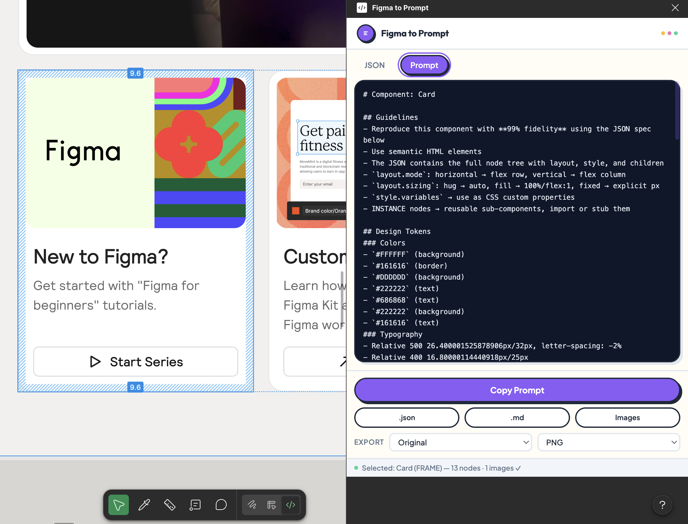
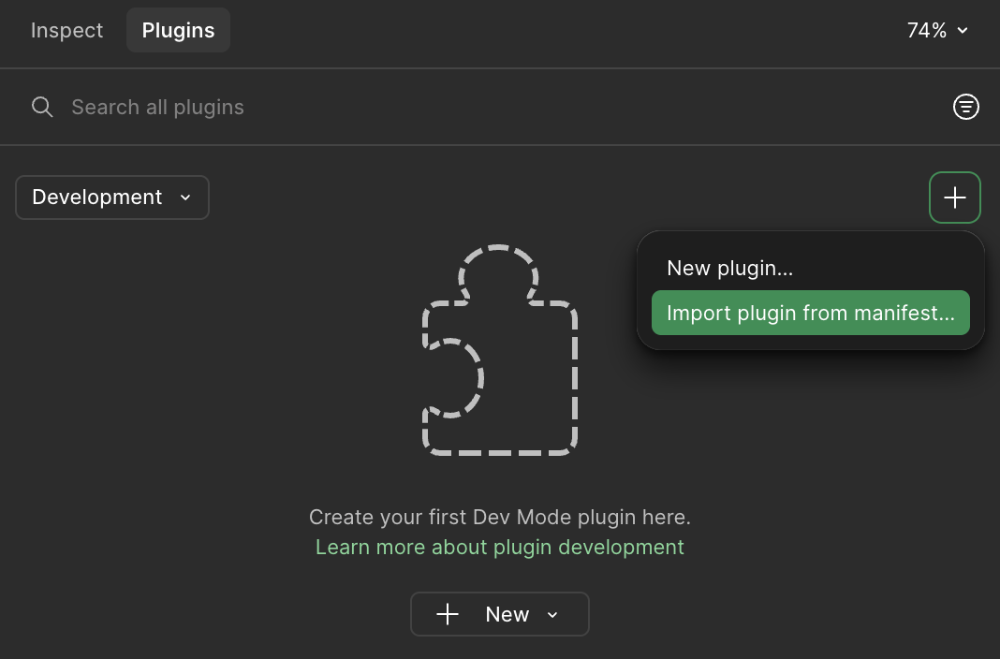

# Figma to Prompt

A Figma plugin that captures a selection as structured JSON and an AI-ready Markdown prompt. Feed the output to ChatGPT, Claude, or any LLM to generate frontend components — then verify the result pixel by pixel without leaving Figma.



## Features

- **JSON export** — Full node hierarchy: layout, style, typography, color, design tokens
- **AI prompt** — Framework-agnostic Markdown with the JSON spec embedded
- **AI package** — A `.figmacapture.zip` with `prompt.md`, node JSON, Figma reference renders, node-mapped assets, and PNG/SVG fallbacks for anything CSS can't express
- **High-fidelity capture** — Auto Layout and Grid, mixed text style ranges, OpenType, raw vector paths, complex strokes, prototype and component semantics, variable modes and bindings
- **Crisp image export** — Lossless 2× PNG by default; 1×–4× PNG/JPG/WebP/AVIF/SVG, or the original uploaded bytes
- **Built-in visual verifier** — Compares an AI screenshot against the latest 1× Figma render; 100% means every RGBA channel matches. Below that, download a correction package with a magenta diff and prioritized error regions
- **Fail-closed** — Any missing reference, asset, exact-size fallback, upscaled image source, or non-deterministic render blocks the download and names the nodes, instead of shipping something incomplete
- **Multi-selection and live updates** — Select any number of nodes; output refreshes with the selection

## Installation

No Node.js, `pnpm`, or source code required — everything happens inside the plugin. Building from source (Option 3) is for maintainers.

### Option 1: Figma Community (recommended)

**[Figma to Prompt on Figma Community](https://www.figma.com/community/plugin/1659492123754225327)** → click **Open in Figma**. Works in both the desktop app and the browser; the plugin lands under **Plugins** → **Saved plugins**.

### Option 2: Download from Releases

Grab the latest `.zip` from [Releases](https://github.com/runkids/figma-to-prompt/releases), unzip it, then follow "[Import into Figma](#import-into-figma)".

### Option 3: Build from source (maintainers only)

```bash
git clone https://github.com/runkids/figma-to-prompt.git
cd figma-to-prompt
pnpm install
pnpm build
```

Then follow "[Import into Figma](#import-into-figma)".

<a id="import-into-figma"></a>

### Import into Figma

> **Note:** Manifest imports require the [Figma Desktop app](https://www.figma.com/downloads/) — they don't work in the browser. Community installs (Option 1) work in both.

1. Open **Figma Desktop** and any design file
2. Click **+** in the top-right corner → **Import plugin from manifest...**
   

3. Select `manifest.json` from the unzipped folder (or the repository root)
4. **Figma to Prompt** appears under **Plugins** → **Development**

Launch it from the plugin menu, or press `⌘ /` (Mac) / `Ctrl /` (Windows) and type `Figma to Prompt`.

## Usage

1. Launch the plugin and select a frame, component, or group
2. Use the **JSON** tab for structured data, or **Prompt** for an AI-ready prompt. Keep **Pixel Perfect**, **Full**, and **Whole frame** on for the most complete result
3. Click **Download AI package** and attach the `.figmacapture.zip` to your AI agent. Text-only workflow? Copy the prompt and download the frame image separately
4. Ask the agent to render at the captured viewport and return a lossless PNG
5. Upload it under **Verify AI screenshot** to get the pixel-match score and an annotated diff
6. Below 100%, download the correction package and hand the whole ZIP back to the AI — it contains everything needed for the next round

### Package contract

- `root.targetViewport` — authoritative screenshot dimensions. Render to this, not to the JSON width/height, which can be fractional
- `root.primaryReferencePath` — visual truth for comparison
- `fidelity/coverage.json` — per-node risk list: why a node needs renderer-backed evidence and which PNG/SVG covers it
- `mcp/figma-locator.json` — per-node `nodeId`, hierarchy, and Figma URL for MCP workflows. Local drafts are marked `local-only` (no file key, so MCP can't reopen them)
- `assets/*.png` — exported at the highest true, non-interpolated density up to 4×. Sources below 2× are kept faithfully but flagged in the package

## Using it with an AI coding agent

### Install the skill (recommended)

This repo ships a [design-to-code skill](skills/figma-to-prompt/SKILL.md) that teaches agents how to read the output. Any agent supporting the skillshare format can use it.

```bash
skillshare install runkids/figma-to-prompt
```

The agent then treats `root.primaryReferencePath` as visual truth, renders at `root.targetViewport`, maps Auto Layout/Grid onto CSS, preserves assets and paint order, and iterates via screenshot comparison.

### Just paste the prompt

Paste the **Prompt** tab into ChatGPT, Claude, Gemini, or Copilot. It already contains conversion guidance, design tokens, and the full component structure.

## Example output

```json
{
  "id": "1:23",
  "name": "Card",
  "type": "FRAME",
  "layout": {
    "mode": "vertical",
    "width": 320,
    "height": 200,
    "gap": 12,
    "padding": { "top": 16, "right": 16, "bottom": 16, "left": 16 },
    "primaryAxisAlign": "min",
    "counterAxisAlign": "min",
    "sizing": { "horizontal": "hug", "vertical": "fixed" }
  },
  "style": {
    "backgroundColor": "#FFFFFF",
    "borderRadius": 8
  },
  "children": [...]
}
```

## Development

Requires [Node.js](https://nodejs.org/) >= 18, [pnpm](https://pnpm.io/), and [Figma Desktop](https://www.figma.com/downloads/).

```bash
pnpm dev:sandbox   # watcher 1 — Figma API side
pnpm dev:ui        # watcher 2 — plugin panel
pnpm test          # pnpm test:watch for watch mode
pnpm build         # outputs dist/code.js + dist/ui.html
```

Reopen the plugin in Figma to load a rebuild.

### Visual fidelity gate (maintainers)

Users should use the **Verify AI screenshot** panel instead. For this repo and CI, compare two PNGs — exits non-zero when the changed-pixel ratio exceeds the maximum:

```bash
pnpm visual:diff -- reference.png implementation.png \
  --pixel-threshold 0.01 \
  --max-diff-ratio 0 \
  --diff visual-diff.png
```

Use exact matching (`0`) for reproducible local renders. A smaller `--pixel-threshold` ignores renderer noise without masking layout, typography, color, or asset differences.

## Tech stack

**TypeScript** · **Preact** (React-compatible aliases) · **Vite** (dual config: sandbox + UI) · **Vitest** · **Tailwind CSS v4** · **vite-plugin-singlefile** (inlines everything into one `ui.html`)

## License

[MIT](LICENSE)
